**Full-Stack & GenAI Developer** · B.Tech CSE (AI & ML), SR University '26 · Hyderabad, India
 
I build Django platforms, multi-agent RAG systems, computer-vision pipelines and Azure / AWS data pipelines — and ship them to the web.

<a href="https://nivedhreddy.vercel.app"><b>▶ Watch the full series — nivedhreddy.vercel.app</b></a>

  

  

 

Each poster opens the live app · source for every project is in my repositories

  

  

  

The continue-watching card and the contribution reel are regenerated every day by a GitHub Action.

